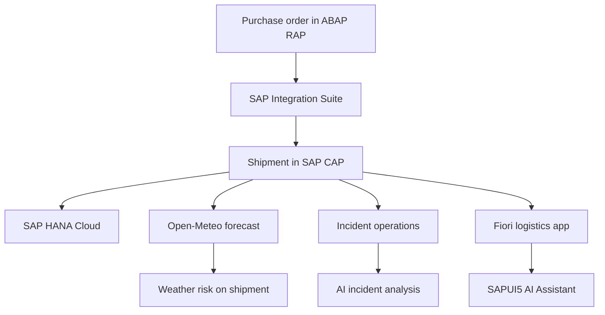

# SmartLogistics BTP

> End-to-end SAP Business Technology Platform portfolio project for an agri-food logistics scenario.

[](#project-status)
[](cap/smartlogistics-extension/test/logistics-service.test.js)
[](https://www.sap.com/products/technology-platform.html)
[](LICENSE)

SmartLogistics BTP demonstrates a clean-core architecture that connects an **ABAP Cloud transactional core** with a **SAP CAP side-by-side logistics extension**. The solution covers purchase orders, shipment operations, weather risk, incident management, generative AI, role-based security and SAP Fiori user experiences.

The fictional business, **GreenFields Foods**, purchases agricultural products and distributes them between suppliers, warehouses and customers. The scenario connects the author's previous agri-food software experience with a six-certification SAP technology stack.

## What is implemented

- ABAP Cloud RAP business object for suppliers, products, purchase orders and items.
- Fiori elements purchase-order application exposed through OData V4.
- CAP Node.js service for shipments, packages and incidents.
- SAP HANA Cloud persistence and Cloud Foundry deployment.
- Published SAP Integration Suite flow from ABAP Cloud to CAP.
- Direct Open-Meteo geocoding and forecast integration from CAP, with deterministic risk classification.
- Fiori elements logistics application with shipment and incident actions.
- Structured AI Incident Analyzer with SAP AI Core mode and a deterministic local fallback.
- SAPUI5 AI Assistant dialog embedded in the logistics Object Page.
- Project-owned operational knowledge with a reproducible lexical retriever.
- XSUAA scopes, role templates and JWT forwarding through SAP Build Work Zone and Destination service.
- Eight automated CAP tests plus manual API scenarios covering `200`, `401`, `403`, `400` and `409` responses.

## End-to-end flow



## Architecture and ownership

| Layer | Technology | Implemented responsibility |
|---|---|---|
| Transactional core | ABAP Cloud, CDS, RAP | Suppliers, products, purchase orders and composed items |
| Side-by-side extension | SAP CAP, Node.js | Shipments, packages, incidents, rules and actions |
| Persistence | SAP HANA Cloud | CAP-owned logistics data |
| Integration | SAP Integration Suite | Approved-order synchronization from ABAP Cloud to CAP |
| External data | Open-Meteo | Destination geocoding and daily weather forecast consumed by CAP |
| User experience | Fiori elements, SAPUI5, Work Zone | Procurement and logistics UIs, custom actions and AI dialog |
| Intelligence | SAP AI Core / Generative AI Hub | Structured incident analysis and conversational shipment assistance |
| Security | XSUAA, Destination service, JWT | Viewer/Operator/Supervisor roles and end-to-end authenticated access |

ABAP Cloud remains the system of record for purchase orders. CAP stores the external purchase-order identifier required by the logistics process; it does not duplicate the purchase-order master.

## AI and grounding: exact scope

The repository deliberately separates three capabilities:

1. **SAP AI mode** — the Incident Analyzer and AI Assistant use SAP AI SDK orchestration when `SMARTLOGISTICS_AI_MODE=sap` and an SAP AI Core binding is available.
2. **Local fallback** — the default development mode returns deterministic responses so the project and tests remain reproducible without cloud AI credentials.
3. **Grounding evidence** — SAP Document Grounding was tested separately with SAP Generative AI Hub Basic Trial. The application repository also contains a local, keyword-weighted lexical retriever over three project-owned Markdown documents. That local retriever is **not vector RAG and is not SAP Document Grounding**.

The three local knowledge documents are:

- `temperature-alert-procedure.md`
- `shipment-delay-escalation-policy.md`
- `weather-risk-route-response.md`

See [AI prompts](ai/prompts/README.md) and [grounding notes](ai/rag/README.md) for the implementation boundaries.

## Security model

| Role | Effective access in the current CAP service |
|---|---|
| `Viewer` | Read shipments, packages and incidents |
| `Operator` | Viewer access plus writes and operational/AI actions |
| `Supervisor` | Cumulative Viewer and Operator scopes; reserved for privileged extensions |

The BTP role collections are `SmartLogistics_Viewer`, `SmartLogistics_Operator` and `SmartLogistics_Supervisor`. Production uses XSUAA. Local development uses named mock users defined in `package.json`; those test passwords are not production credentials.

## Automated verification

The CAP test suite uses `@cap-js/cds-test`. The latest validated result is **8 passing tests**:

- Viewer reads shipments.
- Viewer receives `403` for the AI Assistant.
- Operator executes the AI Assistant.
- Local grounded knowledge returns source references.
- Operator marks a shipment as delivered.
- Operator resolves an incident.
- Invalid dates return `400`.
- A duplicate purchase-order shipment returns `409`.

Run locally:

```bash
cd cap/smartlogistics-extension
npm ci
npm test
```

Manual API examples are available in [`test.http`](cap/smartlogistics-extension/test.http).

## Repository structure

```text
smartlogistics-btp/
├── abap/                         # ABAP Cloud/RAP implementation notes
├── cap/smartlogistics-extension/ # Deployable CAP, Fiori and AI implementation
├── fiori/                        # Portfolio documentation for the UIs
├── integration/                  # Integration Suite documentation
├── ai/                           # Prompt and grounding documentation
├── docs/                         # Scope, architecture, roadmap and evidence
├── postman/                      # API testing notes
└── README.md
```

## Documentation

- [Project scope and delivered capabilities](docs/project-scope.md)
- [Solution architecture](docs/architecture/solution-architecture.md)
- [Architecture boundary decision](docs/decisions/ADR-001-system-boundaries.md)
- [Implementation roadmap](docs/roadmap.md)
- [Backlog](docs/backlog.md)
- [CAP extension](cap/smartlogistics-extension/README.md)
- [Fiori logistics app](fiori/shipments/README.md)
- [AI Assistant](fiori/ai-assistant/README.md)

## Project status

Phases **0–13 are complete**. **Phase 14 — Portfolio is in progress**: the repository documentation now describes the implementation, while curated screenshots, the final architecture visual and a short demo video/script remain to be added. Phase 15 will turn the verified evidence into CV and LinkedIn material.

## SAP certification coverage

| Certification | Evidence in SmartLogistics |
|---|---|
| C_ABAPD | CDS, managed RAP, draft, validations, determinations, actions, DCL and OData V4 |
| C_CPE | CAP Node.js, CDS, custom handlers/actions, HANA Cloud and Cloud Foundry |
| C_CPI | Published ABAP-to-CAP integration flow and API transformation |
| C_AIG | SAP AI SDK orchestration, structured outputs, Document Grounding trial and local lexical grounding fallback |
| C_ADBTP | Subaccount/services, Cloud Foundry, destinations, XSUAA, role collections and trust/JWT flow |
| C_FIORD | Fiori elements, OData annotations, SAPUI5 extensions and Work Zone integration |

## License

This project is licensed under the [MIT License](LICENSE). SAP product names are trademarks of SAP SE or its affiliates. Open-Meteo is an external service. This independent portfolio project is not affiliated with or endorsed by SAP.
