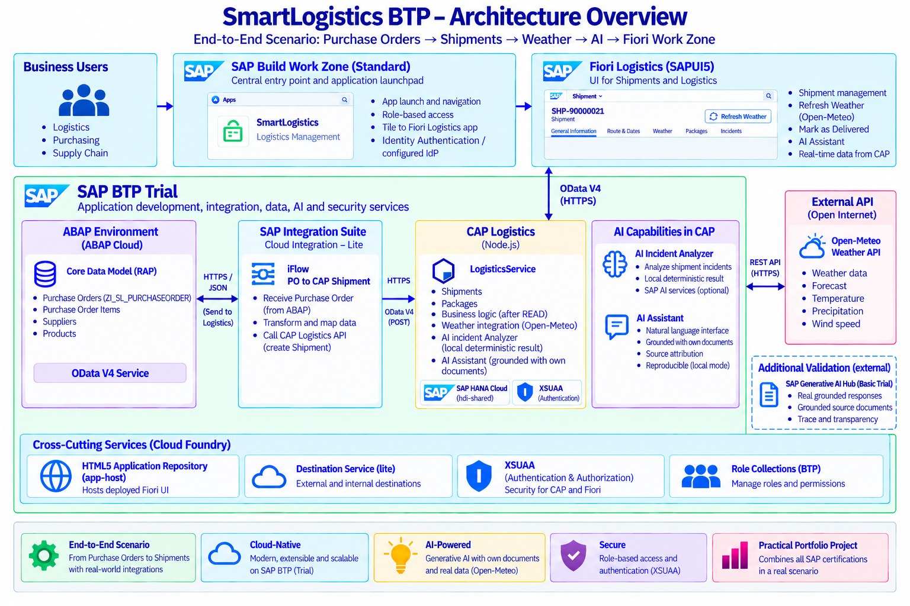
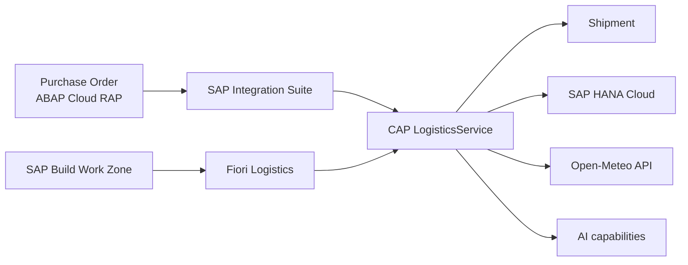

# SmartLogistics BTP

> End-to-end SAP Business Technology Platform portfolio project for an agri-food logistics scenario.

[](https://github.com/narcisohidalgo/smartlogistics-btp/actions/workflows/cap-tests.yml)
[](https://www.sap.com/products/technology-platform.html)
[](LICENSE)

SmartLogistics BTP demonstrates a clean-core architecture that connects an **ABAP Cloud transactional core** with a **SAP CAP side-by-side logistics extension**. The solution covers purchase orders, shipment operations, weather risk, incident management, generative AI scenarios, role-based security, enterprise integration, and SAP Fiori user experiences.

The fictional business, **GreenFields Foods**, purchases agricultural products and distributes them between suppliers, warehouses, and customers. The scenario connects the author's previous agri-food software experience with a six-certification SAP technology stack.

## Architecture



The main business integration flow is:

**Purchase Order → SAP Integration Suite → CAP LogisticsService → Shipment**

CAP acts as the logistics application backend: it persists logistics data in SAP HANA Cloud, calls Open-Meteo directly for weather information, exposes OData V4 services to the Fiori application, and provides the application's incident-analysis and grounded-assistance capabilities.

For a guided walkthrough, see the [End-to-End Demo](docs/end-to-end-demo.md).

## What is implemented

- ABAP Cloud persistence and CDS views for supplier/product master data, plus a managed RAP purchase-order business object with composed items and draft handling.
- Fiori elements purchase-order application exposed through OData V4.
- CAP Node.js `LogisticsService` for shipments, packages, and incidents.
- SAP HANA Cloud persistence through an HDI container and Cloud Foundry deployment.
- Published SAP Integration Suite flow from ABAP Cloud to CAP.
- Technical `system-user` authorization allowing Integration Suite to create shipments without granting interactive application roles.
- Direct Open-Meteo geocoding and forecast integration from CAP, with deterministic weather-risk classification.
- Fiori elements logistics application with shipment, weather, incident, and AI actions.
- SAP Build Work Zone entry point for the logistics application.
- Structured AI Incident Analyzer with an SAP AI integration path and a deterministic local fallback.
- SAPUI5 AI Assistant embedded in the logistics Object Page.
- Project-owned operational knowledge with a reproducible local lexical retriever and source traceability.
- Separate SAP Document Grounding validation using SAP Generative AI Hub Basic Trial / SAP AI Launchpad.
- XSUAA scopes, role templates, role collections, destinations, and JWT forwarding.
- Eight automated CAP tests plus manual API scenarios covering `200`, `401`, `403`, `400`, and `409` responses.

## End-to-end flow



## Architecture and ownership

| Layer | Technology | Implemented responsibility |
|---|---|---|
| Transactional core | ABAP Cloud, CDS, RAP | Suppliers, products, purchase orders, composed items, and logistics handoff |
| Side-by-side extension | SAP CAP, Node.js | Shipments, packages, incidents, business rules, and actions |
| Persistence | SAP HANA Cloud | CAP-owned logistics data through an HDI container |
| Integration | SAP Integration Suite | Purchase-order synchronization from ABAP Cloud to CAP |
| External data | Open-Meteo | Destination geocoding and daily weather forecast consumed directly by CAP |
| User experience | Fiori elements, SAPUI5, SAP Build Work Zone | Procurement and logistics UIs, custom actions, and AI dialog |
| Intelligence | Local AI mode + SAP AI integration path | Incident analysis, grounded assistance, and separate SAP Document Grounding validation |
| Security | XSUAA, Destination service, JWT, Role Collections | Viewer/Operator/Supervisor authorization and authenticated technical integration |

ABAP Cloud remains the system of record for purchase orders. CAP stores the external purchase-order identifier required by the logistics process; it does not duplicate the purchase-order master.

## AI and grounding: exact scope

The repository deliberately separates three capabilities:

1. **SAP AI mode** — the Incident Analyzer and AI Assistant contain an SAP AI integration path used when `SMARTLOGISTICS_AI_MODE=sap` and the required SAP AI service binding is available.
2. **Local reproducible mode** — the development and test environment can return deterministic responses so the project remains reproducible without cloud AI credentials.
3. **Grounding evidence** — SAP Document Grounding was validated separately with SAP Generative AI Hub Basic Trial / SAP AI Launchpad. The application repository also contains a local, keyword-weighted lexical retriever over three project-owned Markdown documents. The local retriever is **not vector RAG and is not SAP Document Grounding**.

The three local knowledge documents are:

- `temperature-alert-procedure.md`
- `shipment-delay-escalation-policy.md`
- `weather-risk-route-response.md`

See [AI prompts](ai/prompts/README.md) and [grounding notes](ai/rag/README.md) for the implementation boundaries.

## Security model

| Identity / Role | Effective access |
|---|---|
| `Viewer` | Read shipments, packages, and incidents |
| `Operator` | Viewer access plus writes and operational/AI actions |
| `Supervisor` | Cumulative Viewer and Operator scopes; reserved for privileged extensions |
| `system-user` | Technical identity restricted to creating `Shipments` for the Integration Suite flow |

The BTP role collections are `SmartLogistics_Viewer`, `SmartLogistics_Operator`, and `SmartLogistics_Supervisor`.

Production uses XSUAA and role-based authorization. SAP Integration Suite authenticates to CAP using a technical client that CAP recognizes as `system-user`. This identity is granted only the authorization required to create shipments.

Local development uses named mock users defined in `package.json`; those test passwords are development-only credentials.

## Source code and reproducibility

Both the **Eclipse ADT ABAP Cloud source** and the **SAP Business Application Studio CAP/Fiori source** are now included in this public repository:

- **ABAP Cloud/RAP:** [`abap/smartlogistics-core/src/`](abap/smartlogistics-core/src/) contains the exported tables, CDS entities, behavior definitions, behavior implementation, classes, communication objects and OData service artifacts. The root [`.abapgit.xml`](.abapgit.xml) points to that subtree for abapGit import into a compatible SAP BTP ABAP Environment. See the [ABAP import and security guide](abap/smartlogistics-core/README.md).
- **CAP/Fiori:** [`cap/smartlogistics-extension/`](cap/smartlogistics-extension/) contains the runnable CAP service, CDS persistence, Fiori Logistics app and automated tests.

**Cloning the Git repository obtains the source code, not an automatically configured SAP landscape.** Importing/activating ABAP objects requires SAP BTP ABAP Environment and Eclipse ADT; full deployment also requires HANA Cloud, XSUAA, destinations, Integration Suite configuration and appropriate credentials. A sanitized Integration Suite iFlow export is included under [`integration/iflows/`](integration/iflows/); its receiver URL and credential alias must be configured in the importing environment. A standalone Fiori Orders UI module is not included. Environment-specific values and generated keys in the ABAP export have intentionally been replaced with non-operational placeholders.

## Automated verification

The CAP test suite uses `@cap-js/cds-test`. GitHub Actions runs the suite automatically for CAP changes on pushes to `main` and pull requests. The validated result is **8 passing tests**:

- Viewer reads shipments.
- Viewer receives `403` for the AI Assistant.
- Operator executes the AI Assistant.
- Local grounded knowledge returns source references.
- Operator marks a shipment as delivered.
- Operator resolves an incident.
- Invalid dates return `400`.
- A duplicate purchase-order shipment returns `409`.

Run locally:

```bash
cd cap/smartlogistics-extension
npm ci
npm test
```

Manual API examples are available in [`test.http`](cap/smartlogistics-extension/test.http).

## Portfolio evidence

| Area | Evidence |
|---|---|
| Architecture | [Final architecture diagram](docs/architecture/smartlogistics-btp-architecture.png) |
| ABAP Cloud / RAP | [Purchase Orders](docs/screenshots/abap-rap/) |
| Integration Suite | [ABAP-to-CAP integration](docs/screenshots/integration-suite/) |
| Fiori Logistics | [Shipment Object Page](docs/screenshots/fiori-logistics/) |
| Open-Meteo | [Weather before/after refresh](docs/screenshots/weather/) |
| AI | [Incident Analyzer, AI Assistant and SAP Document Grounding](docs/screenshots/ai/) |
| Security | [Role Collections and XSUAA authorization](docs/screenshots/security/) |
| Testing | [Automated and manual authorization tests](docs/screenshots/testing/) |
| Demo | [End-to-End Demo](docs/end-to-end-demo.md) |

See the [portfolio screenshots guide](docs/screenshots/README.md) for the curated evidence set.

## Repository structure

```text
smartlogistics-btp/
├── .abapgit.xml                  # abapGit configuration for ADT import
├── abap/smartlogistics-core/src/ # ABAP Cloud CDS, RAP, tables, classes, OData
├── cap/smartlogistics-extension/ # Deployable CAP, Fiori and AI implementation
├── fiori/                        # Portfolio documentation for the UIs
├── integration/                  # Sanitized Integration Suite iFlow export and documentation
├── ai/                           # AI prompts, knowledge and grounding documentation
├── docs/
│   ├── architecture/             # Solution documentation and final architecture visual
│   ├── screenshots/              # Curated portfolio evidence
│   ├── end-to-end-demo.md        # Guided project walkthrough
│   ├── roadmap.md
│   └── project-scope.md
├── postman/                      # API testing notes
└── README.md
```

## Documentation

- [Project scope and delivered capabilities](docs/project-scope.md)
- [Solution architecture](docs/architecture/solution-architecture.md)
- [Final architecture diagram](docs/architecture/smartlogistics-btp-architecture.png)
- [End-to-End Demo](docs/end-to-end-demo.md)
- [Portfolio screenshots](docs/screenshots/README.md)
- [Architecture boundary decision](docs/decisions/ADR-001-system-boundaries.md)
- [Implementation roadmap](docs/roadmap.md)
- [Backlog](docs/backlog.md)
- [ABAP core source and import guide](abap/smartlogistics-core/README.md)
- [CAP extension](cap/smartlogistics-extension/README.md)
- [Integration Suite iFlow source](integration/iflows/README.md)
- [Fiori logistics app](fiori/shipments/README.md)
- [AI Assistant](fiori/ai-assistant/README.md)

## Professional links

- [LinkedIn profile](https://www.linkedin.com/in/narciso-hidalgo/)
- [Architecture overview](docs/architecture/smartlogistics-btp-architecture.png)
- [Technical walkthrough](docs/end-to-end-demo.md)

## SAP certification coverage

| Certification | Evidence in SmartLogistics |
|---|---|
| C_ABAPD | ABAP Cloud, CDS, managed RAP, draft, compositions, actions, behavior definitions, and OData V4 |
| C_CPE | CAP Node.js, CDS, custom handlers/actions, SAP HANA Cloud, and Cloud Foundry |
| C_CPI | Published ABAP-to-CAP integration flow, payload mapping, and API integration |
| C_AIG | Structured AI scenarios, SAP AI integration path, separate SAP Document Grounding validation, and local grounded fallback |
| C_ADBTP | BTP services, Cloud Foundry, destinations, XSUAA, role collections, identity trust, and authorization |
| C_FIORD | Fiori elements, OData annotations, SAPUI5 extensions, and SAP Build Work Zone integration |

## License

This project is licensed under the [MIT License](LICENSE). SAP product names are trademarks of SAP SE or its affiliates. Open-Meteo is an external service. This independent portfolio project is not affiliated with or endorsed by SAP.