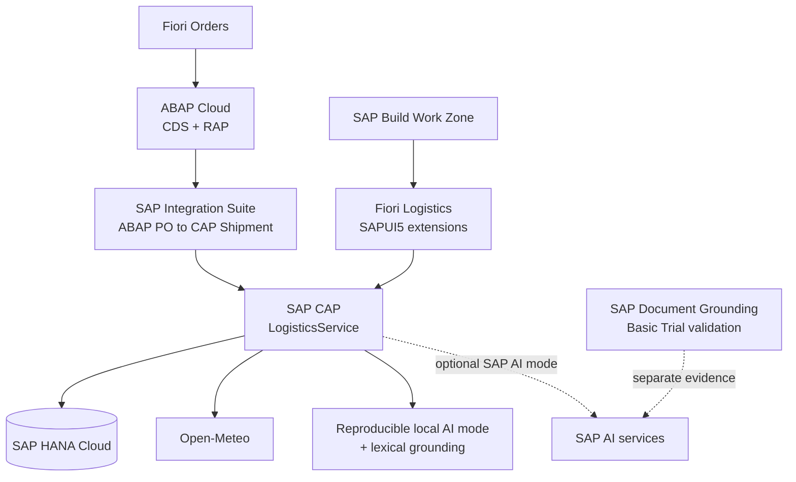

# Solution Architecture

The final portfolio visual is available at [SmartLogistics BTP architecture](smartlogistics-btp-architecture.png).

## Implemented topology

The main end-to-end business path is **ABAP Cloud → SAP Integration Suite → CAP LogisticsService → Shipment**. Weather enrichment is a direct CAP-to-Open-Meteo call. SAP Document Grounding evidence is intentionally separate from the application's reproducible local retrieval path.

## Data ownership

| System | Owned entities | External reference/context |
|---|---|---|
| ABAP Cloud | Supplier, Product, PurchaseOrder, PurchaseOrderItem | None in v1.0 |
| SAP CAP / HANA Cloud | Shipment, Package, Incident | Purchase-order ID from ABAP |
| Open-Meteo | Geocoding and forecast data | Normalized values stored on Shipment |

The same master entity is not independently writable in ABAP Cloud and CAP. CAP stores the purchase-order identifier required for logistics traceability; ABAP remains the source of truth.

## Implemented integration paths

### Purchase-order handoff: ABAP Cloud → Integration Suite → CAP

1. The purchase-order application executes **Send to Logistics**.
2. The published `ABAP PO to CAP Shipment` iFlow receives and transforms the purchase-order payload.
3. The protected CAP logistics API receives the shipment creation request.
4. CAP rejects a second shipment for the same purchase-order identifier with `409 Conflict`.
5. HANA Cloud persists the logistics record.

### Weather: CAP → Open-Meteo

1. An Operator runs `refreshWeather` for a shipment.
2. CAP geocodes the destination city.
3. CAP requests the forecast for the planned-arrival date.
4. Deterministic rules classify LOW, MEDIUM or HIGH risk.
5. CAP stores the forecast and risk fields on the shipment.

Open-Meteo is called directly by CAP. There is no separate weather iFlow in the delivered implementation.

### AI actions

- `analyzeIncident` combines incident and shipment context and returns a validated structured analysis.
- `askAssistant` combines shipment, incidents, weather data and conversation history.
- The default local mode provides deterministic responses for reproducibility and automated testing.
- `SMARTLOGISTICS_AI_MODE=sap` enables the SAP AI SDK integration path when the required SAP AI service binding is available.
- The local lexical retriever supplies relevant excerpts and source labels from project-owned documents; it is not vector RAG.
- SAP Document Grounding was validated separately in SAP Generative AI Hub Basic Trial / SAP AI Launchpad using a vector repository.

## Security model

- ABAP RAP behavior validations protect procurement data quality. Custom procurement DCL/instance-authorization rules are not part of the delivered v1.0 evidence.
- XSUAA defines `Viewer`, `Operator` and `Supervisor` scopes and role templates.
- BTP role collections map business users to those application roles.
- CAP `@requires` and `@restrict` rules protect entities and bound actions.
- Work Zone and the Destination service forward the authenticated JWT to CAP.
- SAP Integration Suite authenticates with a technical identity recognized by CAP as `system-user`; that identity is restricted to creating `Shipments`.
- Integration credentials remain in BTP security material/service bindings and are not committed to the public repository.

## Deployment topology

The CAP multi-target application contains:

- Node.js service module;
- HANA HDI deployer and container;
- Fiori HTML5 module and HTML5 Application Repository content;
- XSUAA service;
- Destination service with JWT forwarding.

Generated `gen`, `dist`, `mta_archives` and `*.mtar` outputs are intentionally excluded from Git.

## Grounding boundary

SAP Document Grounding was validated as a separate Basic Trial experiment. The repository retains a sanitized orchestration configuration as technical evidence, while the runnable local assistant uses a deterministic lexical retriever. These are distinct capabilities and are documented separately.
